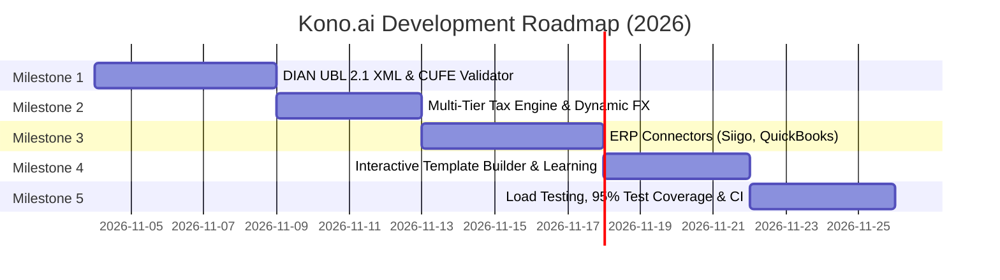

# 🗺️ Kono.ai — Product & Engineering Roadmap

> **Current Status:** v1.0.0-beta (Core Dual-Backend Pipeline, Spatial Heuristics, Arithmetic Validator, Liquid Glass UI & Native Email Inbound are operational).  
> **Upcoming Workload:** ~42 Estimated Engineering Hours across 5 high-impact milestones (Features, Integrations, Hardening, Tests & Docs).

---

## 📌 Milestone Overview

---

## 🚀 Milestone 1: Latin American Electronic Invoicing Compliance (DIAN / SAT / SII)
*Estimated Work: ~10 Hours | Priority: High | Layer: 🦀 Rust Core & 🐍 Python Engine*

Many business invoices in Colombia, Mexico, and Chile are transmitted as paired PDF + XML (UBL 2.1 format) files. This milestone integrates automated XML cross-auditing with visual PDF extractions.

- [ ] **Task 1.1: Rust-based Vectorial UBL 2.1 XML Parser** (~3h)
  - Parse embedded Electronic Invoice XMLs (`AttachedDocument`, `Invoice` tags) with zero overhead.
  - Extract CUFE/CUDE (`UUID`), Digital Signature (`ds:SignatureValue`), and DIAN validation status.
- [ ] **Task 1.2: Hybrid PDF ↔ XML Cross-Reconciliation Engine** (~3h)
  - Reconcile extracted spatial values from PDF (subtotal, taxes, line items) directly against official XML payload.
  - Flag discrepancy if printed PDF and DIAN XML amounts diverge by $> \$0.01$.
- [ ] **Task 1.3: Real-Time DIAN Verification Webhook** (~2h)
  - Query official DIAN tax authority endpoint via CUFE to confirm if invoice is legally accepted, rejected, or canceled.
- [ ] **Task 1.4: Unit & Integration Tests for UBL 2.1 Parser** (~2h)
  - Add 15+ synthetic test cases covering valid, corrupted, and mismatched XML/PDF pairs.

---

## 💵 Milestone 2: Multi-Tier Tax Engine & Dynamic FX Expansion
*Estimated Work: ~8 Hours | Priority: High | Layer: 🐍 Python Engine & ⚛️ Frontend*

- [ ] **Task 2.1: Granular Latin American Withholding & Tax Engine** (~3h)
  - Implement full calculation of statutory withholdings: *Retefuente* (1.5%, 2.5%, 4%), *ReteIVA* (15% of VAT), and *ReteICA* (various municipal rates).
  - Add visual breakdown tiles in Split-Screen auditor (`AuditorPage.tsx`) for withholdings.
- [ ] **Task 2.2: Multi-Currency Failover Service & Real-Time FX** (~2h)
  - Extend `currency_service.py` to support EUR, GBP, MXN, and BRL conversions to COP.
  - Implement fallback providers: Banco de la República official API -> Fixer.io -> Local 48h historical cache.
- [ ] **Task 2.3: Currency Formatting & Locale Persistence** (~1.5h)
  - Enable user-selectable base currency (`COP`, `USD`, `EUR`) in `SettingsPage.tsx` with instant UI re-computation.
- [ ] **Task 2.4: Math Validator Test Suite Expansion** (~1.5h)
  - Deterministic property-based tests using `hypothesis` covering rounding edge cases across currencies.

---

## 🔌 Milestone 3: Accounting & ERP Connectors (Siigo, QuickBooks, Alegra)
*Estimated Work: ~8 Hours | Priority: Medium-High | Layer: 🐍 Python API & 🤖 Integrations*

Automate the direct push of 100% reconciled invoices into cloud accounting ledgers without manual CSV exports.

- [ ] **Task 3.1: Pluggable ERP Adapter Architecture** (~2h)
  - Create abstract `BaseERPAdapter` with `export_invoice()`, `sync_accounts()`, and `validate_credentials()`.
- [ ] **Task 3.2: Siigo Cloud API Connector** (~2.5h)
  - Implement OAuth2 token management and `POST /v1/invoices` payload construction matching Siigo accounts payable schema.
- [ ] **Task 3.3: QuickBooks Online & Alegra Export Endpoints** (~2h)
  - Map invoice line items, tax IDs, and vendor NITs to QBO Bill objects.
- [ ] **Task 3.4: Resilient Retry Worker with Exponential Backoff** (~1.5h)
  - Queue failed ERP exports in Redis with jittered backoff and user alert toasts.

---

## 🎨 Milestone 4: Interactive Point & Click Template Builder
*Estimated Work: ~8 Hours | Priority: Medium | Layer: ⚛️ Frontend & 🐍 Python Engine*

Allow non-technical finance operators to teach Kono how to extract custom or unconventional vendor formats by clicking on bounding boxes.

- [ ] **Task 4.1: Interactive SVG Canvas Bounding-Box Selector** (~3h)
  - Enable drag-to-select regions directly over the PDF render in `DocumentViewer.tsx`.
  - Assign selected box to schema fields (`vendor_name`, `invoice_number`, `tax_id`, `subtotal`, `tax`, `total`).
- [ ] **Task 4.2: Self-Learning Vendor Template Engine** (~2.5h)
  - Automatically infer spatial anchor rules (`above`, `below`, `right_of`) based on user-selected coordinates.
  - Save to PostgreSQL `vendor_templates` table and cache in Redis.
- [ ] **Task 4.3: Template Management & Import/Export Modal** (~1.5h)
  - Visual template preview list in `SettingsPage.tsx` with one-click JSON export/import.
- [ ] **Task 4.4: End-to-End Template Extraction Tests** (~1h)
  - Automated tests verifying that saved templates achieve 100% extraction score on re-ingested files.

---

## 🛡️ Milestone 5: Concurrency Benchmarking, Test Coverage & CI/CD
*Estimated Work: ~8 Hours | Priority: High | Layer: 🦀 Rust, 🐍 Python, 🏗️ DevOps*

- [ ] **Task 5.1: High-Throughput Stress Testing (10,000 Invoices/Hour)** (~2.5h)
  - Implement Locust / k6 load simulation against the folder watcher and REST webhook.
  - Profile Rust threadpool and memory consumption under sustained peak load.
- [ ] **Task 5.2: Test Coverage Push to >95%** (~2.5h)
  - Fill missing test gaps in `backend/python-api/tests` (specifically edge-case WebSocket reconnections and PDF decryption).
  - Add end-to-end Cypress or Playwright tests for frontend Liquid Glass audit workflow.
- [ ] **Task 5.3: Automated GitHub Actions CI/CD Pipeline** (~2h)
  - Continuous integration workflow running `cargo test`, `pytest --cov`, and `npm run test` on every PR.
  - Automated Docker image build and vulnerability scanning with Trivy.
- [ ] **Task 5.4: Developer Documentation & OpenAPI Spec Polish** (~1h)
  - Polish `/docs` Swagger schemas with rich field descriptions, error code examples, and bilingual guides.

---

## 📊 Summary of Planned Workload

| Milestone | Key Deliverable | Est. Hours | Primary Tech Stack |
| :--- | :--- | :--- | :--- |
| **M1: Electronic Invoicing** | DIAN UBL 2.1 XML Parser + CUFE Cross-Auditor | **10h** | 🦀 Rust, 🐍 Python |
| **M2: Advanced Tax & FX** | Granular Withholdings (ReteICA/ReteIVA) + Multi-Currency | **8h** | 🐍 Python, ⚛️ React |
| **M3: ERP Connectors** | Direct Siigo & QuickBooks Online Integration | **8h** | 🐍 Python, 🤖 REST |
| **M4: Visual Template Builder** | Point & Click SVG Bounding Box Learning | **8h** | ⚛️ React, 🧭 Heuristics |
| **M5: Hardening & CI/CD** | 10k Load Benchmarks, 95% Coverage & CI/CD | **8h** | 🦀 Rust, 🐳 Docker, GitHub Actions |
| **TOTAL** | **High-Impact Planned Engineering Work** | **42 Hours** | **Full Stack System** |
